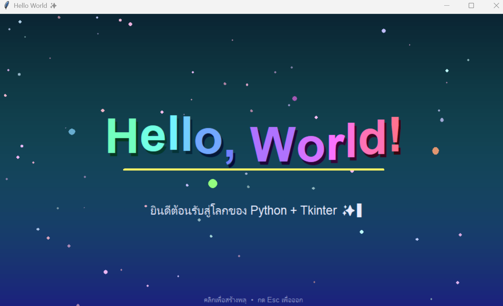

# Hello World Animation ✨

โปรแกรม **Hello, World!** แบบ Animation สวยๆ เขียนด้วย Python + Tkinter ในไฟล์เดียว
ไม่ต้องติดตั้งไลบรารีเพิ่มเติม ใช้แค่ standard library ของ Python



---

## ฟีเจอร์

- 🌌 **พื้นหลังไล่สีเคลื่อนไหว** — โทนม่วง-น้ำเงิน-ฟ้า เปลี่ยนไปเรื่อยๆ ตลอดเวลา
- ⭐ **ดาวระยิบระยับ** — ดาว 70 ดวงลอยขึ้นด้านบน พร้อมเอฟเฟกต์กะพริบ
- 🔤 **ตัวอักษรร่วงลงมาทีละตัว** — "Hello, World!" ตกลงมาพร้อมเอฟเฟกต์เด้ง (bounce)
- 🌊 **ตัวอักษรเต้นเป็นคลื่น** — หลังตกถึงที่แล้วจะเคลื่อนขึ้นลงเป็นจังหวะต่อเนื่อง
- 🌈 **สีรุ้งเปลี่ยนต่อเนื่อง** — แต่ละตัวอักษรมีสีไล่เฉดต่างกัน พร้อมเงาด้านหลัง
- ➖ **เส้นใต้ข้อความ** — ยืดหดตามจังหวะและเปลี่ยนสีตลอดเวลา
- ⌨️ **ข้อความย่อยพิมพ์ทีละตัวอักษร** — พร้อมเคอร์เซอร์กะพริบ (รองรับภาษาไทย)
- 💫 **จุดแสงโคจร** — จุดแสง 4 ดวงวิ่งวนรอบข้อความหลังจากตัวอักษรลงครบ
- 🎆 **พลุเมื่อคลิก** — คลิกเมาส์เพื่อสร้างพลุ (ดูรายละเอียดด้านล่าง)

---

## วิธีควบคุม

| การกระทำ | ผลลัพธ์ |
|---|---|
| **คลิกซ้าย** ที่ตำแหน่งใดก็ได้บนหน้าต่าง | พลุแตกออกมาตรงจุดที่คลิก (สีสุ่มทุกครั้ง) |
| กดปุ่ม **Esc** | ปิดโปรแกรม |
| ลากขอบเพื่อ **ยืด/ย่อหน้าต่าง** | ฉากจัดวางใหม่ให้พอดีกับขนาดหน้าต่าง |

**คลิกได้ไหม?** — ได้ครับ! คลิกซ้ายตรงไหนก็ได้ คลิกรัวๆ ได้เลย พลุแต่ละครั้งจะมีประกายประมาณ 46 จุด
พุ่งออกเป็นวงกลม ตกลงตามแรงโน้มถ่วงและค่อยๆ จางหายไป

> หมายเหตุ: มีเฉพาะคลิกซ้ายเท่านั้นที่สร้างพลุ ส่วนคลิกขวาและปุ่มอื่นๆ ไม่มีผลใดๆ
> และการยืด/ย่อหน้าต่างจะรีเซ็ตฉากใหม่ (พลุที่ยังค้างอยู่จะหายไป)

---

## วิธีรัน

### 1) ตรวจสอบว่ามี Python

เปิด Terminal / Command Prompt / PowerShell แล้วพิมพ์:

```bash
python --version
```

ต้องเป็น **Python 3.x** (ถ้าเป็น macOS/Linux ให้ลอง `python3 --version`)
หากยังไม่มี ดาวน์โหลดได้ที่ <https://www.python.org/downloads/>

### 2) ตรวจสอบว่ามี Tkinter

Tkinter มากับ Python อยู่แล้วบน **Windows** และ **macOS** (ตัวติดตั้งจาก python.org)
ลองทดสอบด้วยคำสั่ง:

```bash
python -c "import tkinter; print('tkinter OK')"
```

ถ้าขึ้น `ModuleNotFoundError` บน **Linux (Ubuntu/Debian)** ให้ติดตั้งเพิ่ม:

```bash
sudo apt install python3-tk
```

### 3) รันโปรแกรม

เข้าไปที่โฟลเดอร์ที่เก็บไฟล์ แล้วรัน:

```bash
cd "ชื่อโฟลเดอร์ของคุณ"
python hellogui.py
```

> macOS/Linux: ใช้ `python3 hellogui.py`
> VS Code: เปิดไฟล์ `hellogui.py` แล้วกดปุ่ม ▶ Run Python File มุมขวาบนได้เลย

หน้าต่างโปรแกรมขนาด 960×560 จะเปิดขึ้นมา ไม่ต้องเปิดเบราว์เซอร์และไม่ต้องมีอินเทอร์เน็ต

---

## ปรับแต่งเอง

แก้ค่าต่างๆ ที่ต้นไฟล์ `hellogui.py` ได้เลย:

| ตัวแปร | ความหมาย | ค่าเริ่มต้น |
|---|---|---|
| `TITLE` | ข้อความหลัก | `"Hello, World!"` |
| `SUBTITLE` | ข้อความย่อยที่พิมพ์ทีละตัว | `"ยินดีต้อนรับสู่โลกของ Python + Tkinter ✨"` |
| `HINT` | ข้อความคำแนะนำด้านล่างจอ | `"คลิกเพื่อสร้างพลุ  •  กด Esc เพื่อออก"` |
| `WIDTH`, `HEIGHT` | ขนาดหน้าต่างเริ่มต้น | `960`, `560` |
| `FPS_DELAY` | หน่วงเวลาต่อเฟรม (มิลลิวินาที) ยิ่งน้อยยิ่งลื่น | `16` (~60 fps) |

ปรับแต่งเพิ่มเติมในโค้ด:

- **ความเร็วการเต้นของตัวอักษร** — ค่า `0.07` ในฟังก์ชัน `animate_title`
- **จำนวนดาว** — `range(70)` ในฟังก์ชัน `build_scene`
- **จำนวนประกายของพลุ** — `range(46)` ในฟังก์ชัน `on_click`

---

## ข้อกำหนดของระบบ

- Python 3.x พร้อม Tkinter
- ไม่ต้องติดตั้งแพ็กเกจเพิ่มด้วย `pip`
- ใช้งานได้บน Windows, macOS และ Linux

## โครงสร้างโปรเจกต์

```
.
├── hello.py          # โค้ดโปรแกรม hello test
├── hellogui.py          # โค้ดโปรแกรม (ไฟล์เดียวจบ)
├── screenshot.png       # ภาพตัวอย่างที่แสดงใน README
└── README.md
```
